<p align="center">
  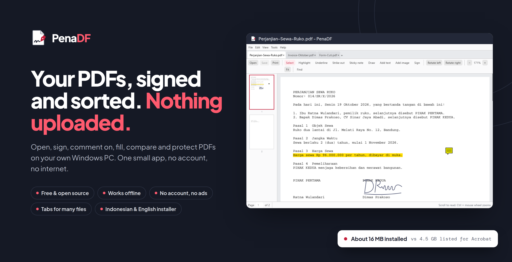
</p>

<p align="center">
  <b>A small, offline PDF app for Windows and macOS.</b> Open, sign, comment on, fill, organize, compare and protect PDFs on your own PC.<br>
  Free and open source · no account · nothing uploaded.
</p>

<p align="center">
  <a href="https://github.com/daefery/penadf/releases/latest/download/PenaDF-Setup.exe"></a>
  <a href="https://github.com/daefery/penadf/releases/latest/download/PenaDF-macOS.dmg"></a>
  <a href="https://github.com/daefery/penadf/releases/latest/download/PenaDF-windows-x64.zip"></a>
</p>

<p align="center">
  <a href="LICENSE"></a>
  
  
  
</p>

<p align="center"><a href="README.id.md">Baca dalam Bahasa Indonesia</a></p>

---

## How it works

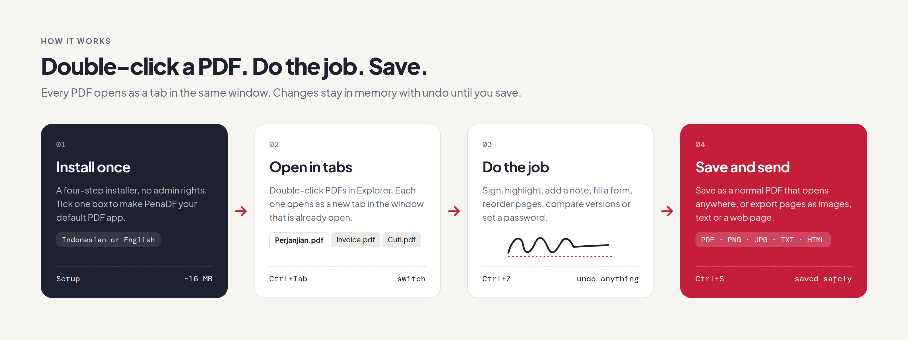

1. **Install once.** Four steps, no administrator rights. On the last page, tick **Make PenaDF my default PDF app**; Windows Settings opens on PenaDF's page and you choose it for `.pdf` with one click. Windows lets only you make that choice, never an installer.
2. **Open in tabs.** Double-click PDFs in Explorer. Each opens as a new tab in the PenaDF window that is already open. Opening a file that is already open switches to its tab. **Ctrl+Tab** switches, **Ctrl+W** or middle-click closes.
3. **Do the job.** Sign, highlight, add a sticky note, draw, add text or an image, fill a form, reorder or rotate pages, compare with another version, or lock it with a password. **Ctrl+Z** undoes anything.
4. **Save and send.** **Ctrl+S** writes a normal PDF that opens anywhere (saved to a temporary file first, so a failed save never damages the original). Or export pages as PNG/JPEG, the text as `.txt`, or the PDF as a self-contained web page.

## What you get

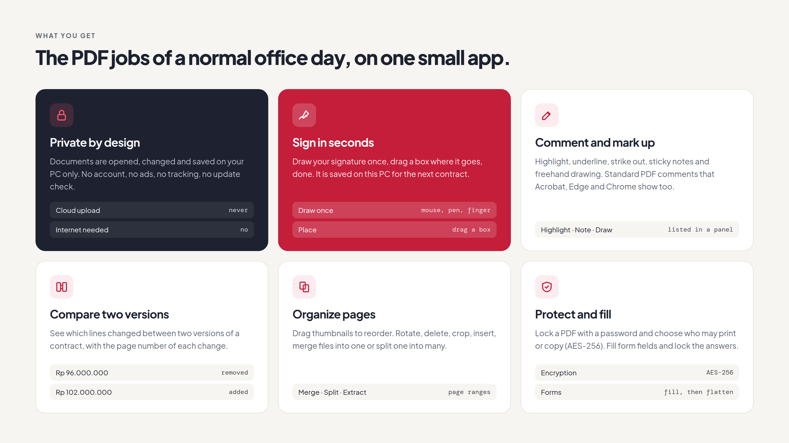

| Job | In PenaDF |
|---|---|
| **Create PDFs** | From images (PNG, JPEG, BMP, GIF, WebP, TIFF) and text files. Word, Excel and PowerPoint are converted by Microsoft Office or LibreOffice if one is installed. |
| **Sign** | Draw your signature once and place it with a drag. It is saved on this PC for next time. |
| **Comment** | Highlight, underline, strike out, sticky notes, freehand drawing. Standard PDF comments, so Acrobat, Edge and Chrome show them. **View → Comments** lists and deletes them. |
| **Fill forms** | Text fields and checkboxes, with an option to lock the answers (flatten). |
| **Organize** | Drag thumbnails to reorder; rotate, delete, crop, insert a blank page or another file; merge files; split by page groups; extract pages. |
| **Compare** | Line-by-line text changes between two versions, with page numbers. |
| **Protect** | Open password and/or permissions (print, copy, edit, comment), AES-256. Remove protection with the permissions password. |
| **Export** | Pages to PNG/JPEG, text to `.txt`, PDF to `.html`. |
| **Read and copy** | Tabs, fast rendering, zoom, find; select text with the mouse (double-click for a word, Ctrl+A for the page) and copy it with Ctrl+C or the right-click menu; print, undo/redo, password-protected files. |

**Not included:** editing existing text in place, PDF to Word, OCR for scans, cloud features and sending documents to others for signature. The Sign tool places a picture of your signature; it is not a certified electronic signature (PSrE).

## The app

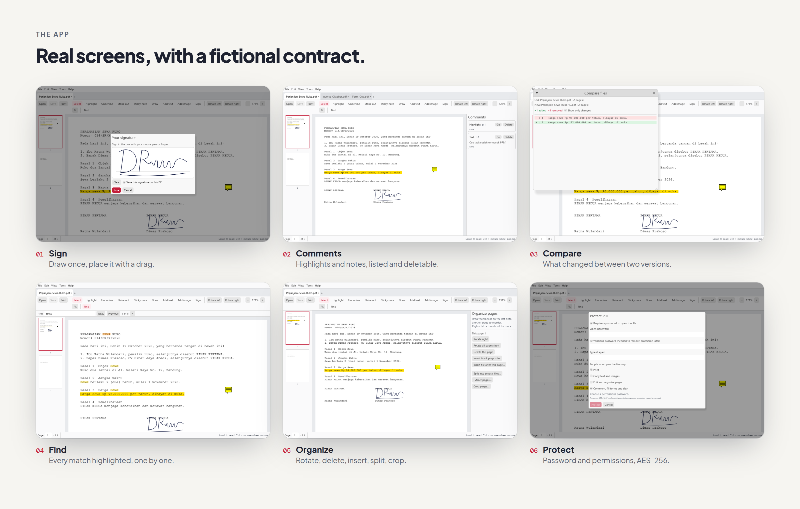

<details>
<summary>Full-size screenshots</summary>

| | |
|---|---|
| 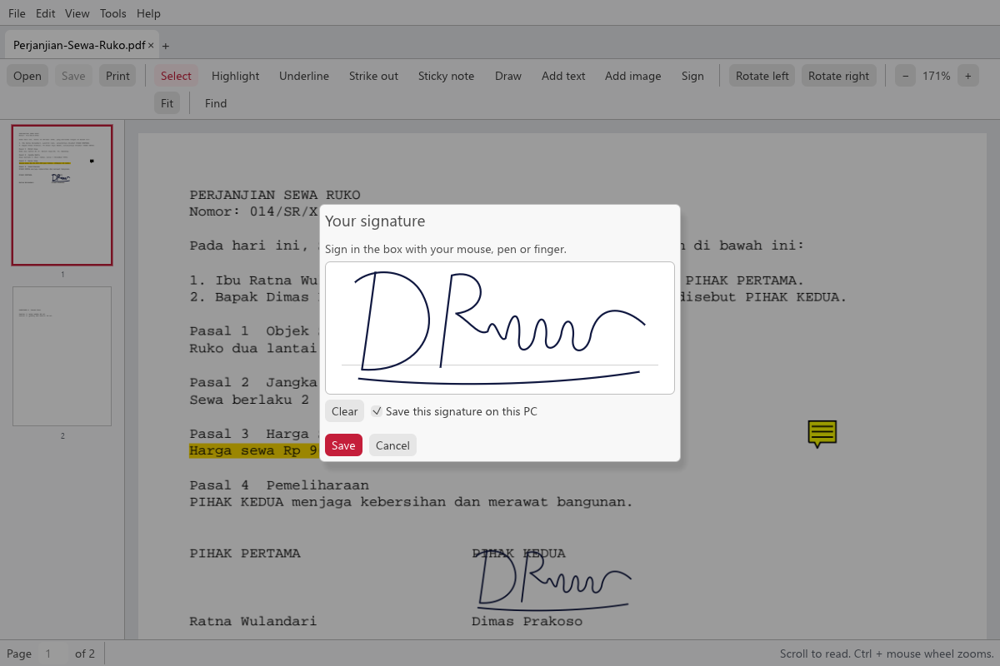 | 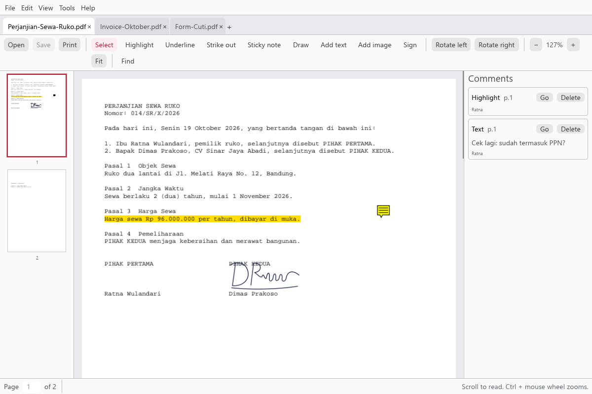 |
| **Sign.** Draw once; saved for next time. | **Comments.** Every highlight and note, with Go and Delete. |
| 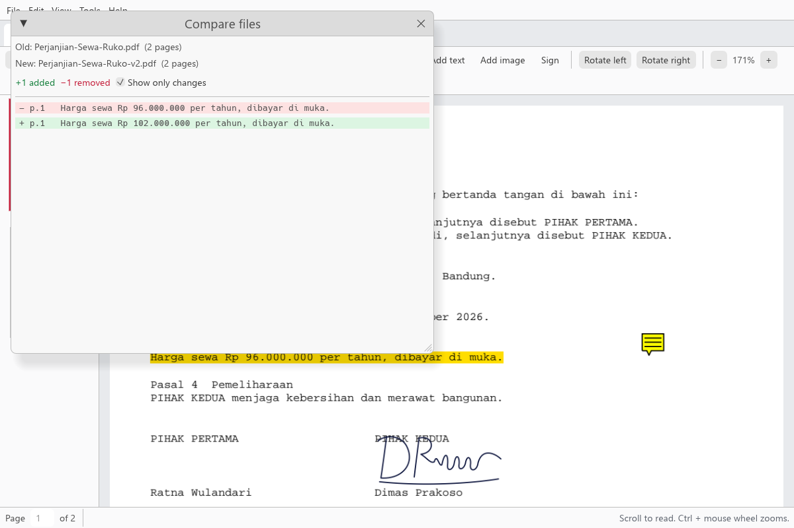 | 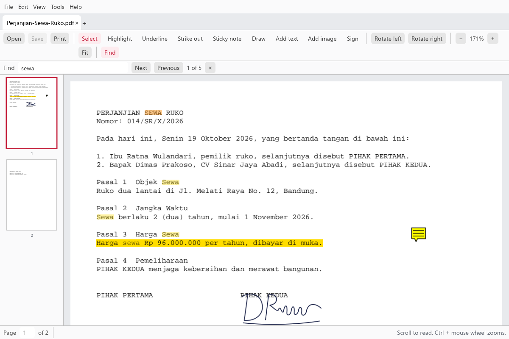 |
| **Compare.** The changed price clause between two versions. | **Find.** All matches highlighted; the current one in orange. |
| 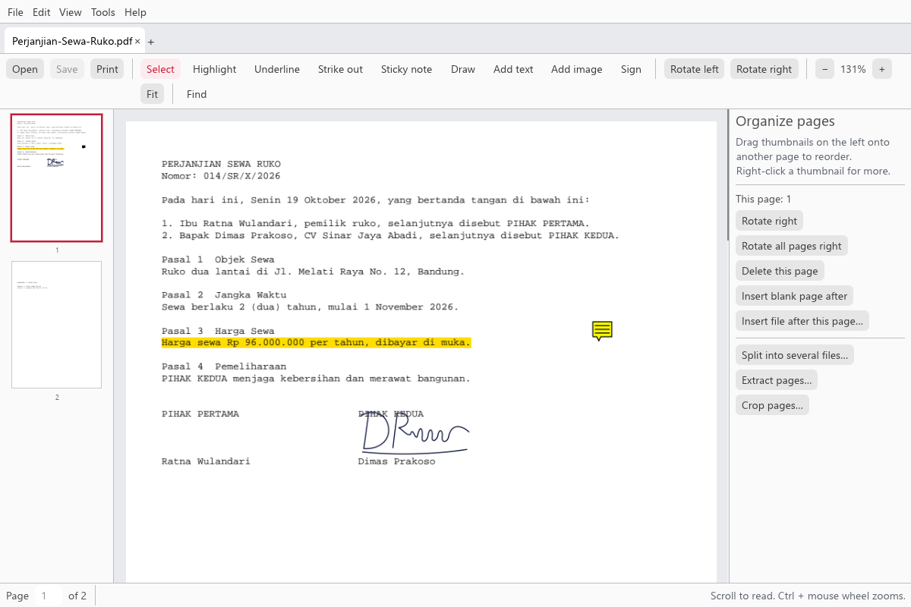 | 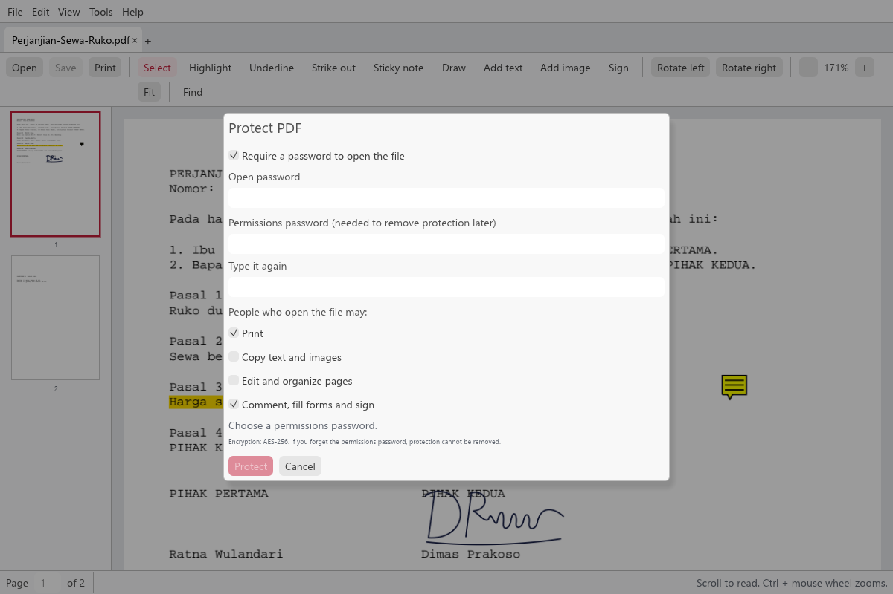 |
| **Organize.** Page tools next to the thumbnails. | **Protect.** Password and permissions, AES-256. |
| 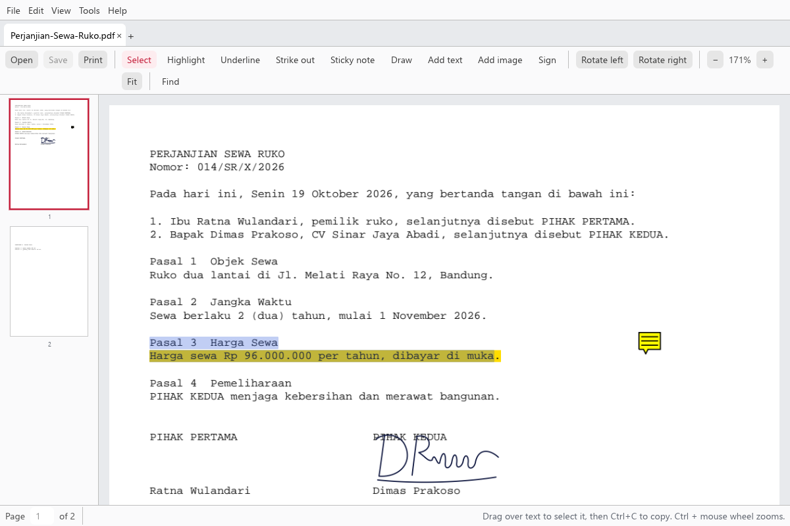 | |
| **Select and copy.** Drag over text, then Ctrl+C. | |

</details>

All screenshots are of the real app, taken automatically with fictional sample documents (`cargo run --example make_sample`).

## Install

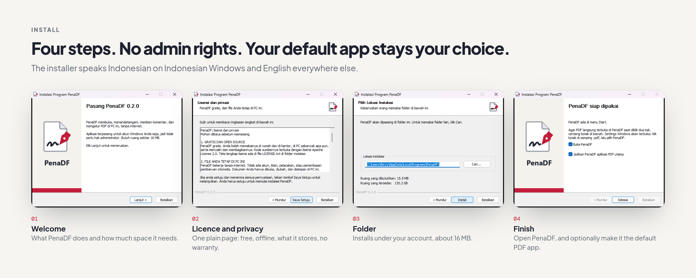

The installer shows Indonesian on Indonesian Windows and English everywhere else. Step 2 is a one-page plain summary you accept: free to use, your files stay on your PC, what PenaDF stores, what the installer changes, and no warranty ([English](installer/agreement-en.txt) · [Indonesia](installer/agreement-id.txt)).

## Download

| | File | |
|---|---|---|
| **Recommended** | [**PenaDF-Setup.exe**](https://github.com/daefery/penadf/releases/latest/download/PenaDF-Setup.exe) | Installs for your account (no admin rights), adds a Start menu entry and lets you make PenaDF your default PDF app. |
| Windows, portable | [**PenaDF-windows-x64.zip**](https://github.com/daefery/penadf/releases/latest/download/PenaDF-windows-x64.zip) | Unzip anywhere and run `PenaDF.exe` (keep `pdfium.dll` next to it). Cannot be chosen as the default PDF app. |
| **macOS** | [**PenaDF-macOS.dmg**](https://github.com/daefery/penadf/releases/latest/download/PenaDF-macOS.dmg) | Universal: Apple Silicon and Intel Macs, macOS 11 or later. Open it and drag PenaDF onto Applications. |

Both links always point to the [latest release](https://github.com/daefery/penadf/releases/latest); checksums are in [`SHA256SUMS.txt`](https://github.com/daefery/penadf/releases/latest/download/SHA256SUMS.txt).

**Requirements:** Windows 10 or 11 (64-bit), or macOS 11 Big Sur or later. About 16 MB of disk on Windows.

If Windows shows "Windows protected your PC", choose **More info → Run anyway**: the installer is not code-signed yet. IT staff: `PenaDF-Setup.exe /S` installs silently; `/LANG=id` or `/LANG=en` picks the language.

### On a Mac

1. Open `PenaDF-macOS.dmg` and drag **PenaDF** onto **Applications**.
2. Open PenaDF. macOS says it cannot check the app, because PenaDF is not notarized by Apple yet.
3. Open **System Settings → Privacy & Security**, scroll down and click **Open Anyway** next to PenaDF, then open it again and click **Open**. Only the first time.

To open PDFs with PenaDF on double-click: select any PDF in Finder, press **⌘I**, choose PenaDF under **Open with**, then **Change All…**. On a Mac, ⌘ replaces Ctrl in every shortcut below, and printing opens the document in Preview's print dialog.

## Size and speed

Measured on a Windows 11 laptop (18 Oct 2026):

| | |
|---|---|
| Installed size | 16 MB (`PenaDF.exe` 8 MB + `pdfium.dll` 7 MB) |
| Installer download | 6 MB |
| Window open, repeat launches | about 50 ms |
| Memory with a document open | about 110 MB private, 150 MB working set |

For comparison, Adobe lists 4.5 GB of disk space for Acrobat on Windows. The first launch of a freshly downloaded copy can take several seconds while Windows scans the new file.

## Keyboard

| Keys | Action |
|---|---|
| Ctrl+O | Open (in a new tab) |
| Ctrl+W | Close tab |
| Ctrl+Tab / Ctrl+Shift+Tab | Next / previous tab |
| Ctrl+S / Ctrl+Shift+S | Save / Save as |
| Ctrl+Z / Ctrl+Y | Undo / Redo |
| Ctrl+C | Copy selected text |
| Ctrl+A | Select all text on the page |
| Ctrl+F | Find |
| Ctrl+P | Print |
| Ctrl + / Ctrl − / Ctrl+0 | Zoom in / out / fit width |
| Page Up / Page Down | Previous / next page |
| Esc | Back to the Select tool |

## Architecture

One Rust crate. Everything except the window lives in the library and is tested without a display.

| Module | Responsibility |
|---|---|
| `src/engine.rs` | Loads PDFium, opens and saves documents, the few raw PDFium calls `pdfium-render` does not wrap |
| `src/ops/` | Every document operation as plain functions over PDF bytes: `create`, `pages`, `markup`, `forms`, `protect`, `export`, `compare` |
| `src/geometry.rs` | Screen ↔ PDF coordinates for rotated and cropped pages |
| `src/gui/` | Page view, open-document state with undo, tab strip and tab bar, theme |
| `src/instance.rs` | One window per user: later launches hand their files over as tabs (local socket) |
| `src/winshell.rs` | Windows default-app check and the Settings deep link |
| `src/macos.rs` | macOS: receives PDFs opened from Finder and hands them to the window as tabs |
| `src/ui/` | The window: menus, tool bar, panels, dialogs |
| `installer/` | NSIS installer script, agreement texts, side image |
| `tests/` | End-to-end tests on real PDFs, plus simulated mouse input on the page view and tab bar |

## Build from source

PenaDF builds for Windows from Linux or WSL, with no Visual Studio; the macOS app is built on a Mac (or the GitHub Actions macOS runner) with `scripts/build-macos.sh`:

```bash
rustup target add x86_64-pc-windows-gnullvm
# llvm-mingw: https://github.com/mstorsjo/llvm-mingw/releases  (ucrt, ubuntu, x86_64)
# NSIS 3:     https://nsis.sourceforge.io/Download              (portable zip)
scripts/test.sh                     # all tests against the bundled PDFium (Linux)
scripts/build-installer.sh          # dist/PenaDF-Setup-<version>.exe and dist/PenaDF-windows-x64.zip
python3 docs/visuals/render.py      # regenerate the README visuals
```

On Windows with the MSVC toolchain, `cargo build --release` works too; copy `vendor/pdfium/windows/pdfium.dll` next to the `.exe`. CI ([`.github/workflows/ci.yml`](.github/workflows/ci.yml)) tests on Linux, Windows and macOS on every push, and builds the installer, the zip and the `.dmg` for tagged releases.

## Brand


A page with its corner folded and a red fountain-pen nib finishing a signature: *pena* is Indonesian for pen. At 16 to 32 px the icon is redrawn simpler so it stays clear in Explorer. Generated by [`scripts/make_icon.py`](scripts/make_icon.py).

## Privacy

PenaDF does not connect to the internet. It has no accounts, analytics, ads or update checks, and documents never leave your PC. It stores only your saved signature (if you choose to) and one display setting in `%APPDATA%\PenaDF`. Details: [PRIVACY.md](PRIVACY.md).

## Contributing

Bug reports and pull requests are welcome; see [CONTRIBUTING.md](CONTRIBUTING.md).

## Licence

Code: [Apache License 2.0](LICENSE). See [NOTICE](NOTICE).

The PenaDF name, logo and icon are not covered by the code licence; see [TRADEMARKS.md](TRADEMARKS.md). Forks are welcome under their own name.

Third-party components: [PDFium](https://pdfium.googlesource.com/pdfium/) (BSD-3-Clause, Google) shipped as `pdfium.dll` from [pdfium-binaries](https://github.com/bblanchon/pdfium-binaries); [pdfium-render](https://github.com/ajrcarey/pdfium-render), [egui/eframe](https://github.com/emilk/egui), [lopdf](https://github.com/J-F-Liu/lopdf) and other Rust crates (MIT / Apache-2.0); README fonts Plus Jakarta Sans and DM Mono (SIL OFL 1.1, `docs/fonts/`). The full list with licence texts ships in every download as `THIRD-PARTY-NOTICES.txt` ([`scripts/make_notices.sh`](scripts/make_notices.sh)).

"Adobe" and "Acrobat" are trademarks of Adobe Inc.; PenaDF is not affiliated with Adobe.
